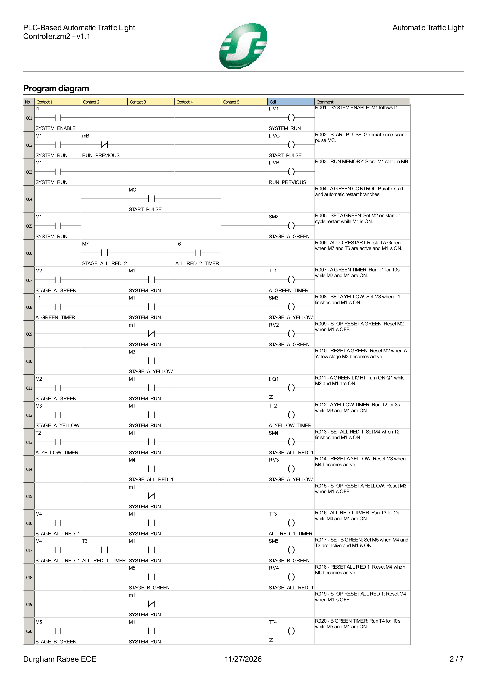
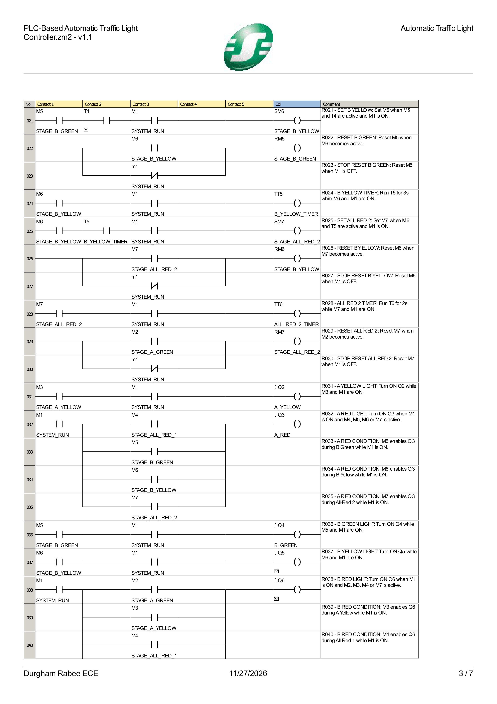
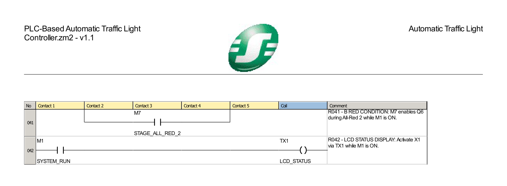
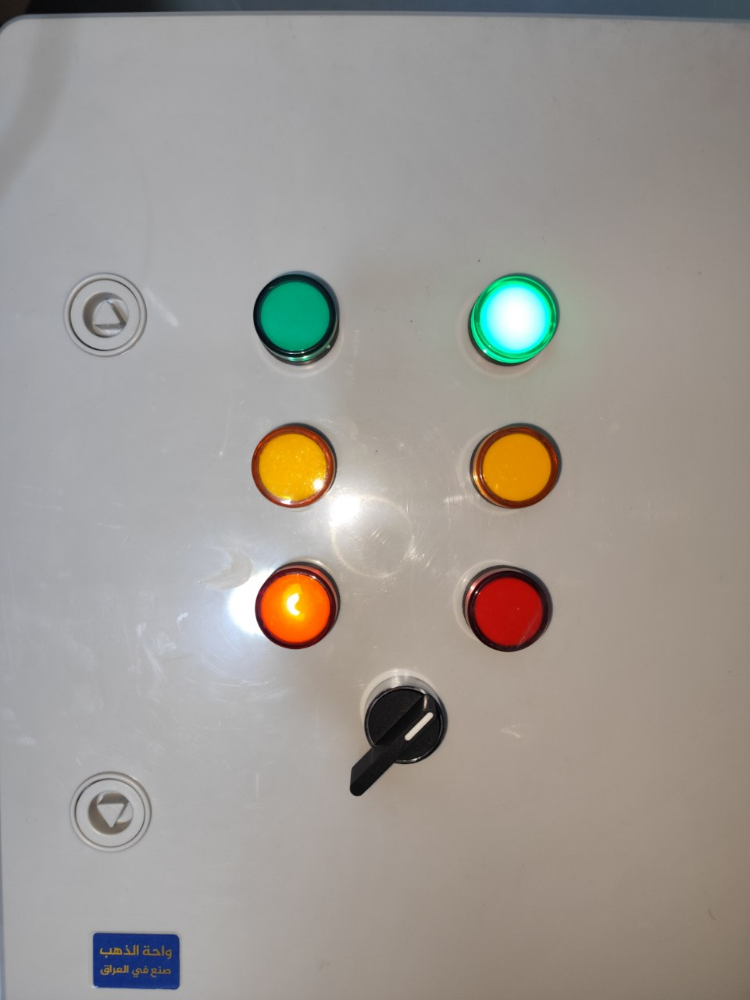
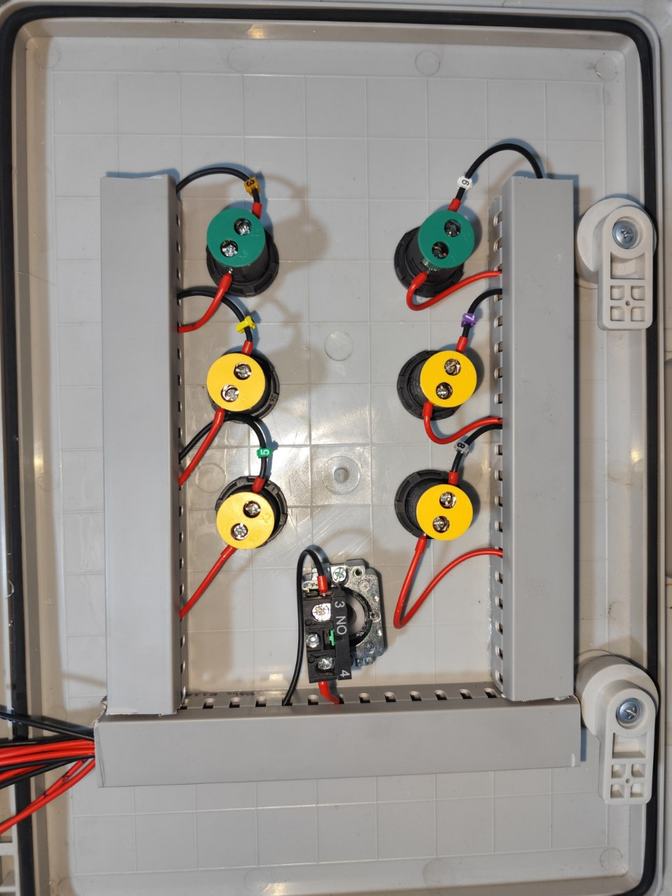
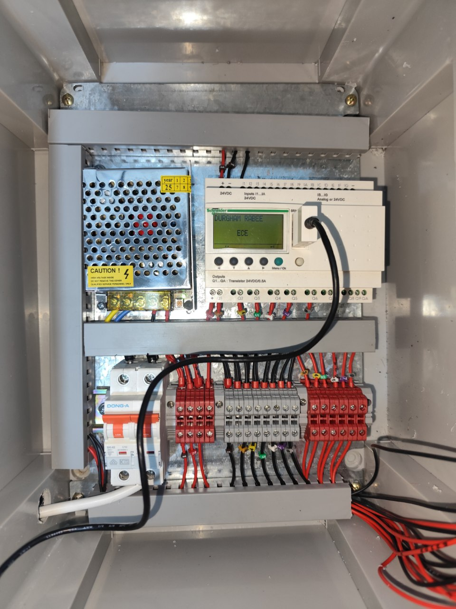

# PLC-Based Automatic Traffic Light Controller

A two-direction traffic light controller built in **Zelio Soft 2** using Ladder Diagram (LD). It alternates right of way between directions A and B, with an all-red clearance interval before each changeover.

| Project information | Details |
| --- | --- |
| Author | Durgham Rabee ECE |
| Version | 1.1 - Final release |
| Report date | 27 November 2026 |
| Programming language | Ladder Diagram (LD) |
| Controller | Schneider Electric Zelio Logic SR3B262BD |
| Program cycle time | 20 ms (10 × 2 ms) |
| Ladder rows | 42 / 240 |
| Used resources | 1 digital input, 6 digital outputs, 9 auxiliary relays, 6 timers, 1 text block |
| Memory latching | Disabled for the listed outputs, auxiliary relays and timers |
| Hardware input filter | Slow (3 ms) |
| Watchdog action | Inactive |
| Zx keys | Inactive |

## Project files

- [Zelio Soft 2 project](project/plc-based-automatic-traffic-light-controller-v1.1.zm2) — editable Ladder Diagram program.
- [Full program report](docs/plc-based-automatic-traffic-light-controller-v1.1.pdf) — module settings, ladder rungs, I/O assignments, timers, and LCD configuration.
- **[Ladder diagram, page 2](docs/ladder/ladder-v1.1-part-1-r001-r020.png)** · **[Ladder diagram, page 3](docs/ladder/ladder-v1.1-part-2-r021-r040.png)** · **[Ladder diagram, page 4](docs/ladder/ladder-v1.1-part-3-r041-r042.png)**

- [File migration manifest](docs/file-manifest.md) - verified original-to-final filename mapping.

### Ladder logic preview

## How the controller works

The `I1` enable input drives the run relay `M1`. On enable, `MB` holds the previous run state so `MC` can generate a one-scan start pulse. This pulse starts the A green stage. Stage relays `M2`–`M7` drive the lamps and their associated timers. When the second all-red timer finishes, the program returns to A green automatically.

| Stage | Direction A | Direction B | Relay | Timer | Preset |
| --- | --- | --- | --- | --- | --- |
| 1 | Green | Red | `M2` | `T1` | 10 s |
| 2 | Yellow | Red | `M3` | `T2` | 3 s |
| 3 | Red | Red | `M4` | `T3` | 2 s |
| 4 | Red | Green | `M5` | `T4` | 10 s |
| 5 | Red | Yellow | `M6` | `T5` | 3 s |
| 6 | Red | Red | `M7` | `T6` | 2 s |

The six **Function A** timers have a combined preset of **30 seconds** per cycle. Both red outputs are on during each **2-second** clearance interval.

## V1.1 — Master enable and reset

- `M1` enables all six stage SET commands, timer control coils and physical outputs.
- Normally closed `m1` contacts reset every stage relay `M2`–`M7` when `I1` is switched off.
- Function A timers reset when their control signals are removed.
- Restart begins at A green via the start pulse `MC`, after the controller has registered the OFF state.
- The nominal traffic cycle remains 30 seconds. The ladder expands from 37 to 42 rows.

## I/O and LCD

| Address | Function |
| --- | --- |
| `I1` | System enable |
| `Q1` | Direction A green |
| `Q2` | Direction A yellow |
| `Q3` | Direction A red |
| `Q4` | Direction B green |
| `Q5` | Direction B yellow |
| `Q6` | Direction B red |

Rung `R042` enables text block `X1` through coil `TX1` while `M1` is active. The final report configures the Zelio LCD with four lines: **TRAFFIC CONTROL**, **VERSION 1.1**, **SYSTEM RUNNING**, and **DURGHAM RABEE**.

## Simulate in Zelio Soft 2

1. Open the `.zm2` file, switch to **Simulation** mode, and start the simulation.
2. Turn on `I1` and watch `Q1`–`Q6` through a full cycle. Check that `Q3` and `Q6` are on during each all-red interval and that the sequence repeats from A green.
3. Switch `I1` off during each of the six stages. Verify all outputs and stage relays turn off and timers reset. Switch it on again and verify A green starts a fresh 10-second interval. Test rapid OFF/ON transitions that the PLC can register.
4. With `I1` on, open the simulated LCD to inspect the text from `X1`.

## V1.1 final report and test status

The [seven-page final report](docs/plc-based-automatic-traffic-light-controller-v1.1.pdf), dated 27 November 2026, is the documentation reference for this release. Pages 2-4 contain R001-R042; pages 5-7 list resources, timer presets and the final LCD text. The three uploaded ladder images match the visible row ranges on those pages; part 3 is cropped to remove unused space.

| Evidence | Recorded result | Scope |
| --- | --- | --- |
| Author's report, page 1 | "Simulation and hardware tests passed." | User/author-reported outcome; not independently reproduced during this repository update. |
| Uploaded hardware photos | Assembled front panel, door wiring and internal PLC installation are visible. | Still photos document construction and one lamp state; they do not prove a complete timed sequence. |
| Detailed hardware test log | Not supplied in the available files or retrieved conversation. | Per-stage selector tests, rapid OFF/ON tests and power-loss/restart results are not individually claimed as passed. |

The operating sequence and reset behavior above describe the documented program. The simulation steps are a repeatable checklist, not a new test execution. The editable ZM2 file is preserved byte-for-byte from the upload; it was not opened in Zelio Soft 2 or transferred to a PLC during this update.

European daylight saving is enabled in the report. The documented ladder uses elapsed-time timers rather than clock schedules.

## Hardware gallery

| Front panel | Door wiring | Internal assembly |
| --- | --- | --- |
|  |  |  |

The front-panel photo shows the right green lamp and left red lamp illuminated. Direction A/B labels cannot be established from the photo alone. The internal photo shows the PLC connected by a programming cable; it does not establish which software version was loaded when photographed.

No hardware video is present in the inspected repository tree or its Git history. No video demonstration is claimed for this release.

## File organization and release history

- `project/`: editable Zelio Soft 2 program.
- `docs/`: V1.1 final report and `ladder/` image extracts.
- `hardware/photos/`: original hardware photographs with descriptive filenames.
- [File migration manifest](docs/file-manifest.md): original names, final paths, sizes and checksums.

| Version | Changes |
| --- | --- |
| V1.1 final - 27 November 2026 | Final seven-page report, updated rung comments, LCD VERSION 1.1, organized uploads and hardware gallery; documented author-reported test outcome. |
| V1.1 | Master enable/reset, restart from A green after a registered OFF state; 42 ladder rows and a 20 ms program cycle. |
| V1.0 | Earlier 37-row program with an 18 ms program cycle, retained in Git history. |

All eight uploaded binary files were copied to their final paths and checked byte-for-byte before the old working-tree paths were removed. The files retain their original Git blob hashes. Previous commits remain accessible; no history was rewritten. See the manifest for links to originals at the pre-organization commit.

## Verification and safety

**Educational demonstration only.** The logic is not a certified traffic-signal controller and does not implement the independent fail-safe monitoring, fault-response architecture, or regulatory requirements needed for public-road deployment. The inactive watchdog setting must not be interpreted as an acceptable safety configuration for real traffic control.

## Author and rights

**Durgham Rabee** — Electronics & Communications Engineering. © 2026. All rights reserved unless otherwise stated.

[Engineering portfolio](https://github.com/Durghamrabee)
