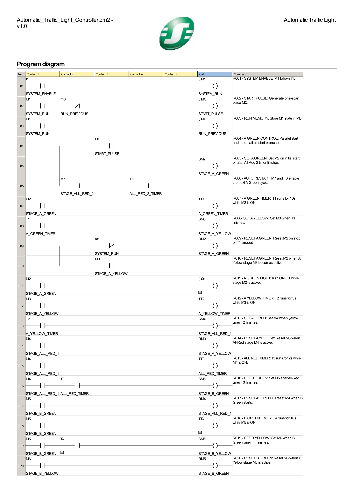
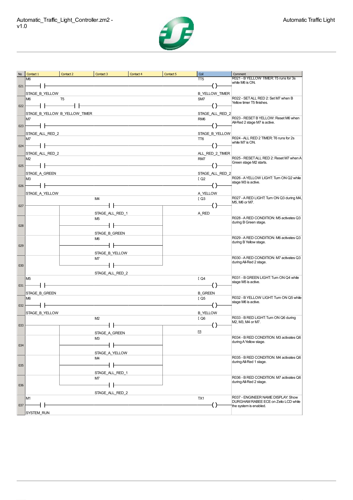

# Automatic Traffic Light Controller

A two-direction traffic light controller built in **Zelio Soft 2** using Ladder Diagram (LD). It alternates right of way between directions A and B, with an all-red clearance interval before each changeover.

| Project information | Details |
| --- | --- |
| Author | Durgham Rabee ECE |
| Version | 1.0 |
| Controller | Schneider Electric Zelio Logic SR3B262BD |
| Program cycle time | 18 ms (9 × 2 ms) |
| Hardware input filter | Slow (3 ms) |
| Watchdog action | Inactive |
| Zx keys | Inactive |

## Project files

- [Zelio Soft 2 project](project/Automatic_Traffic_Light_Controller.zm2) — editable Ladder Diagram program.
- [Full program report](docs/Automatic%20Traffic%20Light%20Controller.pdf) — module settings, ladder rungs, I/O assignments, timers, and LCD configuration.
- **[Ladder diagram, page 2](docs/ladder-diagram-part-1.png)** · **[Ladder diagram, page 3](docs/ladder-diagram-part-2.png)**

### Ladder logic preview

## How the controller works

The `I1` enable input drives the run relay `M1`. On enable, `MB` holds the previous run state so `MC` can generate a one-scan start pulse. This pulse starts the A green stage. Stage relays `M2`–`M7` drive the lamps and their associated timers. When the second all-red timer finishes, the program returns to A green automatically.

| Stage | Direction A | Direction B | Relay | Timer | Preset |
| --- | --- | --- | --- | --- | --- |
| 1 | Green | Red | `M2` | `T1` | 10 s |
| 2 | Yellow | Red | `M3` | `T2` | 3 s |
| 3 | Red | Red | `M4` | `T3` | 2 s |
| 4 | Red | Green | `M5` | `T4` | 10 s |
| 5 | Red | Yellow | `M6` | `T5` | 3 s |
| 6 | Red | Red | `M7` | `T6` | 2 s |

The six **Function A** timers have a combined preset of **30 seconds** per cycle. Both red outputs are on during each **2-second** clearance interval.

## I/O and LCD

| Address | Function |
| --- | --- |
| `I1` | System enable |
| `Q1` | Direction A green |
| `Q2` | Direction A yellow |
| `Q3` | Direction A red |
| `Q4` | Direction B green |
| `Q5` | Direction B yellow |
| `Q6` | Direction B red |

Rung `R037` enables text block `X1` through coil `TX1` while `M1` is active. The block is configured to display **DURGHAM RABEE ECE** on the Zelio LCD.

## Simulate in Zelio Soft 2

1. Open the `.zm2` file, switch to **Simulation** mode, and start the simulation.
2. Turn on `I1` and watch `Q1`–`Q6` through a full cycle. Check that `Q3` and `Q6` are on during each all-red interval and that the sequence repeats from A green.
3. Toggle `I1` off and back on to observe the stop and restart behavior.
4. With `I1` on, open the simulated LCD to inspect the text from `X1`.
